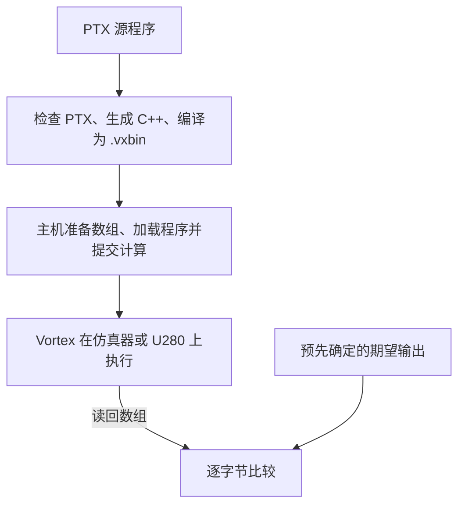

# Vortex-U280

Vortex-U280 是一个 GPU 兼容编译的研究原型。它把一部分用 NVIDIA PTX 编写的整数程序转换成开源 Vortex GPU 能执行的程序，再用事先算好的答案验证结果。验证覆盖软件仿真、电路仿真和装有 Vortex 的 Alveo U280 FPGA 加速卡。

PTX 是一种描述 GPU 线程要做什么的低层语言。比如，向量加法会让每个线程读取两个整数，求和后写回。Vortex 使用自己的指令体系，项目中的编译器负责转换程序，运行时负责准备输入、启动计算和读回结果。

## 快速上手

下面三步只需要 Git 和 Python，无需 GPU、U280 或 FPGA 工具链。公开副本已在 Windows 的 Python 3.13 和 WSL Ubuntu 22.04 的 Python 3.10 上通过自测。如果系统的 Python 命令是 `python3`，把下文的 `python` 换成 `python3`。[自测记录](results/publication-check-20261123-v1/summary.json)

### 1. 下载并运行自测

```bash
git clone https://github.com/slishysun974/Vortex-U280.git
cd Vortex-U280
python -B -m unittest discover -s tests -v
```

末尾出现 `OK` 表示已运行的测试通过。缺少特定平台或历史构建材料时，一部分检查会标为 `skipped`。这一步检查编译前端、主机运行器和验证工具的行为。

### 2. 从向量加法 PTX 生成 C++

在仓库根目录运行下面的命令。两个配置文件指定这次使用的仿真目标及其硬件配置。

```bash
python -B scripts/ptx_module.py prepare ptx/samples/vadd_u32.ptx --target-lock configs/candidates/block32-v1/target_lock.json --hardware configs/candidates/block32-v1/native_smoke.json --output build/readme-vadd-v1
```

终端会报告 `SOURCE_PREPARED`。打开输出目录中的 `kernel_body.hpp` 可以看转换后的计算，`abi.json` 记录输入、输出和长度参数的字节布局。`prepare` 到源代码准备为止，后续由 `build` 生成 Vortex 镜像 `.vxbin`。重复尝试时换一个输出目录名。

### 3. 复核一次已有的仿真结果

```bash
python -B scripts/e_acceptance/runtime_unseen_check.py --corpus configs/acceptance/e-runtime-unseen-20261111-v1 --run results/e-runtime-unseen-sim-20261111-v1/simx --out readme-simx-check-v1.json
```

预期输出为 `PASS 48`，详细结果写入 `readme-simx-check-v1.json`。这一步读取已保存的 SimX 仿真输出，逐条核对完整数组和启动参数。想再运行一次时，给 `--out` 换一个新文件名。[四路复核命令](docs/PUBLICATION.md#公开副本检查)

## 向量加法怎样走完一遍

例如，把 `[1, 2, 3]` 和 `[4, 5, 6]` 相加，期望得到 `[5, 7, 9]`。每个 GPU 线程根据自己的编号算出数组下标。只有下标小于数组长度的线程才读取输入和写回结果，这样即使用完整线程组启动，也能处理数组末尾不足一组的情况。[向量加法 PTX 源码](ptx/samples/vadd_u32.ptx)



这里的「主机」是发起计算的电脑。它把输入交给 Vortex，等计算完成后读回结果。比较时还会检查输出区前后预留的保护值，以发现越界写入。[模块构建器](scripts/ptx_module.py) · [主机运行时](scripts/ptx_runtime.py)

## 目前验证到了哪里

已有三类 `u32`（32 位无符号整数）程序完成验证。它们是数组复制、向量加法和逐元素乘加，用例包括零长度、线程组尾部和整数溢出。同一批 48 个独立用例在 SimX（指令级模拟）、处理器电路仿真、FPGA 加速单元仿真和物理 U280 上各通过 48/48。[独立验证报告](docs/E_RUNTIME_UNSEEN_ACCEPTANCE.md)

在同一张 U280 上做 Iris 分类，65,533 条样本的设备用时中位数为原生 C++ **98.03 毫秒**、PTX **101.35 毫秒**，两种实现输出一致。[六档同卡对照](docs/IRIS_U280_NATIVE_PTX_BRIEF.md)

Iris 花卉三分类已在三个模型和 U280 实卡各通过 9 组功能用例。扩容后，150 条真实数据的分折留出预测正确 140 条。65,533 行压力测试中，U280 设备忙时为 101.290 ms，本机 Core Ultra 7 255H 单线程为 0.365 ms（中位数）。报告包含逐次计时、设备计数器、温度、功率和复现命令。[Iris 性能与 CPU 对照](docs/IRIS_U280_PERFORMANCE_20261123.md) · [单样本实卡演示](docs/IRIS_U280_RESULTS_20261123.md)

当前编译范围是项目定义的 PTX 整数子集。浮点、通用分支和共享内存留待扩展，物理板卡故障恢复尚未验证。[PTX 兼容性规范](docs/PTX_COMPATIBILITY_PROFILE.md)

## 从哪里继续

| 想做什么 | 入口 |
|---|---|
| 找到样例、编译代码、测试和结果 | [项目总览](docs/PROJECT_OVERVIEW.md)按文件夹说明去哪里找。 |
| 从头构建并在本机仿真运行 | [本地构建环境](environment/native-sim/README.md)列出固定的 Vortex 源码、工具链和 SimX 运行命令。构建与运行使用新的目录。 |
| 在有权限的 U280 上复现 | [服务器与上板指南](docs/SERVER_GUIDE.md)列出 XRT、FPGA 镜像、主机运行库和板卡检查条件。 |
| 阅读性能和协作研究 | [U280 配对性能](docs/PTX_U280_ALIGNED_MPM_20261122.md) · [三轮 AI 协作试验](docs/PROJECT_OVERVIEW.md#已取得的成果) · [研究计划](docs/RESEARCH_PLAN.md) |

提交改动时，在新目录重跑相关检查，记录命令、退出码和验证范围。[项目协作约定](AGENTS.md)
