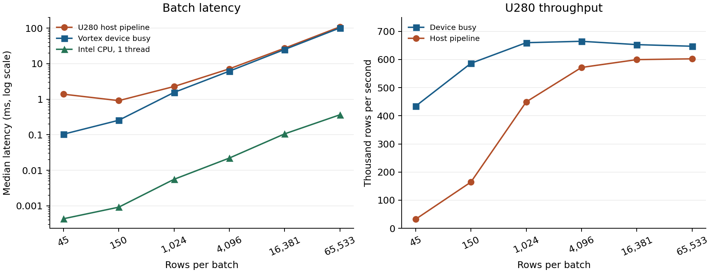

# Iris 扩容实验：U280 运行状态与本机 CPU 对照

**同一批 65,533 行合成鸢尾花特征，固定 Vortex 核在 U280 上计算用时 101.290 ms，本机 Core Ultra 7 255H 单线程用时 0.365 ms。** 两者为 30 次正式测量的中位数，距离和类别均与有理数答案逐字节相符。计入上传、提交等待和结果回读，U280 的中位时间为 108.799 ms，吞吐量约 **60.2 万行/秒**。这次测量覆盖 200 MHz、1 核、8 warp、4 lane 的 Vortex 实现和基线 PTX 内核。[机器可读对照结果](../results/iris-perf-comparison-20261123-v1/comparison.json) · [内核源码](../ptx/samples/iris_nearest_centroid_u32.ptx)

## 样本与准确率

**150 条真实记录各做一次留出预测，共正确 140 条（93.33%）。** 真实类别按 setosa、versicolor、virginica 排列时，三个类别分别答对 50、46、44 条。5 折各 30 条，正确数依次为 29、26、28、28、29。上一轮固定 105/45 划分的结果仍是 40/45（88.89%）。本次每折重新拟合中心，两种统计使用不同训练与测试划分，不能据此推断分类器精度提升。[每折训练与测试行号](../results/iris-perf-freeze-20261123-v1/corpus/folds.json) · [原实验](IRIS_U280_RESULTS_20261123.md)

| 真实类别（行）／预测（列） | setosa | versicolor | virginica |
|---|---:|---:|---:|
| setosa | 50 | 0 | 0 |
| versicolor | 0 | 46 | 4 |
| virginica | 0 | 6 | 44 |

每类 50 条原始记录，按类内原序对 5 取模，逐折留出 10 条。为保持已验收内核的固定分母 35，从每类剩余 40 条中按固定规则选 35 条训练，另 5 条在本折闲置。各折训练／测试行号无交集。原数据的 150 行共有 149 种不同特征向量，第 143 行在其测试折与一条训练记录的四个特征完全相同。全部 10 个误分类仍通过 CPU 与设备的逐距离核验。[原始数据与许可](../experiments/iris-u280/data/README.md) · [划分及有理数答案生成器](../experiments/iris-u280-perf/corpus.py)

性能实验固定使用原来的 105 行训练所得模型。45 行批次为原测试集，150 行批次为全部原始记录。其余四档使用同一个确定性序列的不同长度前缀。该序列含 **65,533 个互异的合成向量**，四维各自落在真实数据观测范围内，排除了原有特征向量。它们用于检验吞吐量、地址边界和输出正确性，无真实物种标签。最大批次使用 2,048 个 32 线程块，最后 3 行为哨兵。[冻结数据清单与哈希](../results/iris-perf-freeze-20261123-v1/corpus/freeze.json)

## 性能结果



U280 **设备忙时**取单核 `MCYCLE` 的前后差，按实测 200 MHz 换算。**主机路径**为同一次启动的三段实测时间之和：上传三个分配、提交并等待、回读完整输出。模块和缓冲区已就绪。CPU 计量从调用计算函数到返回，输入、输出均在本机内存。下表的倍数是设备忙时中位数除以 CPU 中位时间。P95 使用 30 次实测排序后的第 29 个值。[U280 逐次测量](../results/iris-board-perf-20261123-v2/returned/iris-board-perf-20261123-v2/u280-xrt/samples.jsonl) · [CPU 逐次测量](../results/iris-perf-cpu-20261123-v1/samples.csv)

| 行数 | U280 设备忙时 ms | U280 主机路径中位／P95 ms | CPU 计算中位／P95 µs | 设备忙时／CPU | U280 主机路径 万行/s |
|---:|---:|---:|---:|---:|---:|
| 45 | 0.104 | 1.386 / 1.490 | 0.433 / 0.606 | 239.4× | 3.25 |
| 150 | 0.256 | 0.912 / 1.547 | 0.916 / 1.613 | 279.1× | 16.45 |
| 1,024 | 1.552 | 2.279 / 2.390 | 5.575 / 9.128 | 278.4× | 44.94 |
| 4,096 | 6.163 | 7.166 / 7.351 | 22.080 / 34.887 | 279.1× | 57.16 |
| 16,381 | 25.094 | 27.327 / 27.886 | 105.884 / 143.103 | 237.0× | 59.94 |
| 65,533 | 101.290 | 108.799 / 110.096 | 364.688 / 714.905 | 277.7× | 60.23 |

从 16,381 行扩大到 65,533 行，U280 主机路径吞吐只增加约 0.5%。在最大档，设备忙时约占主机路径的 93.1%（中位数之比）。即使单列设备计算，与本机单线程仍相差约 278 倍。45 行档的输出回读中位时间高于 150 行档，原始记录保留了这一现象；本次未确定其成因。[逐阶段与分位数](../results/iris-perf-comparison-20261123-v1/comparison.json)

## U280 在运行时做了什么

| 行数 | 设备忙周期中位数 | 退休 warp 指令中位数 | 每忙周期退休 warp 指令 | 上传／提交等待／回读中位时间 ms |
|---:|---:|---:|---:|---:|
| 45 | 20,729.5 | 4,555 | 0.220 | 0.249 / 0.443 / 0.668 |
| 150 | 51,161.5 | 11,581 | 0.226 | 0.231 / 0.582 / 0.083 |
| 1,024 | 310,473.5 | 74,048 | 0.239 | 0.274 / 1.880 / 0.104 |
| 4,096 | 1,232,667.5 | 296,000 | 0.240 | 0.428 / 6.515 / 0.218 |
| 16,381 | 5,018,894.5 | 1,183,855 | 0.236 | 1.250 / 25.462 / 0.669 |
| 65,533 | 20,258,057.5 | 4,735,087 | 0.234 | 4.162 / 101.748 / 2.777 |

每次启动前后，从 core 0 各读两次 base MPM 的 `MCYCLE`、`MINSTRET`。相同空闲区间的两读必须一致，跨启动的差值必须为正。**1,736 次读数全部返回成功**，最先的两次相同输入还核对了退休指令数。上表逐阶段分别取中位数。单个样本的主机路径总时间在求分位数前相加。设备计数衡量该核的执行活动，本实验未观测 warp 占用率或 HBM 实际带宽。[全部计数器原值](../results/iris-board-perf-20261123-v2/returned/iris-board-perf-20261123-v2/u280-xrt/counter-reads.jsonl) · [计数器定义](PTX_U280_ALIGNED_MPM_20261122.md)

**温度与功率。** 采样线程以 0.5 s 为目标间隔读取同一 PCI 槽的 hwmon 接口，首末样本相距 5.97 s，共 11 个时点。两个 `power1_input` 接口的样本中位数分别为 **29.17 W、29.14 W**，两路观测值合计覆盖 **29.00–29.32 W**；这两个接口属于同一张卡。FPGA 温度为 **33–34 °C**，HBM 为 **28–29 °C**。XRT 在序列前后分别报告 29.09 W 和 28.79 W，均无功率告警。数据是短窗口整卡读数，无法给出单次推理能耗、瞬时峰值或相对 CPU 的能效。[传感器逐次记录](../results/iris-board-perf-20261123-v2/returned/iris-board-perf-20261123-v2/u280-xrt/sensors.jsonl) · [温度与整卡功率汇总](../results/iris-perf-comparison-20261123-v1/comparison.json)

## 测量协议与边界

- **板卡。** 本次为 `0000:b1:00.1`，XRT index 3、HOST 256 MiB，D10 xclbin 和 D12 库通过当次门禁。沿用首轮校验的 v1.2 逐字节参数读取模块，vxbin SHA-256 为 `9ae0e644040d13d558b58d2e5c8dd502a71a82017202168161bf2e09267ddcdd`。模块装载一次，同一 context 依次执行 2 次计数探针、5 折准确率启动、30 次预热和 180 次正式计时。六档批量在每轮轮换起始次序，每档有 5 次预热和 30 次正式观察。[板测结果](../results/iris-board-perf-20261123-v2/result.json) · [板端测量实现](../experiments/iris-u280-perf/measure.py)
- **CPU。** 本机 Intel Core Ultra 7 255H，WSL2 Linux，G++ 11.4.0，`-O3 -march=native -fno-lto`，一个软件线程固定在 WSL 逻辑 CPU 0。编译器记录内核部分基本块使用 32 B 向量。与板端使用同一输入顺序、模型参数、距离与胜者规则。每次计时前复位输出，计时后逐字核对完整分配。比较基于内存就绪的 CPU；整机 CPU 多线程、其他 CPU 实现、频率锁定、CPU 功耗和专用 GPU 未测试。[CPU 构建与运行回执](../results/iris-perf-cpu-20261123-v1/summary.json) · [C++ 内核](../experiments/iris-u280-perf/cpu_kernel.cpp)
- **正确性。** 每个板端样本重新上传特征、模型和带保护区的输出初值。完成事件后回读全输出并记录 SHA-256，输入及模型全区再次回读比较。核验端对齐每个事件的几何、指针参数、顺序、计数器及完整输出哈希，另比对每个用例留存的一份完整输出。两端分别通过全部 217 次。SSH、板端和本地接收均退出 0，板端传回 57 份文件。本机固定 WSL 的项目 Python 自测为 314 通过、2 跳过；本轮新增三种模型性能运行均为 `NOT_RUN`。[离线核验实现](../experiments/iris-u280-perf/analyze.py) · [项目自测](../results/iris-selftest-perf-20261123-v1/summary.json)
- **解释范围。** U280 主机路径包含每次模型参数上传和输出初始化；模块装载、首次分配、诊断计数器、输入完整性回读、哈希核验和 SSH 均在这一定义之外。CPU 使用同一精度的原生优化实现，两端使用了不同的编译器和执行模型。频率、向量化和内核实现等因素没有逐项做单变量实验。本次可判断这组实现和规模下的延迟，不能将倍数外推为芯片的通用性能差异。

## 复现与原件

从项目根目录执行以下命令，可用冻结输入、板端回读与 CPU 原始逐次时间重新核对，并生成新的数值摘要。图表可选，绘图需要 Matplotlib。重跑板卡与 CPU 的完整命令见[实验入口](../experiments/iris-u280-perf/README.md)。

```sh
python -B experiments/iris-u280-perf/comparison.py \
  results/iris-perf-freeze-20261123-v1/corpus \
  results/iris-board-perf-20261123-v2/returned/iris-board-perf-20261123-v2/u280-xrt \
  results/iris-perf-cpu-20261123-v1 --output iris-comparison-new.json
```
